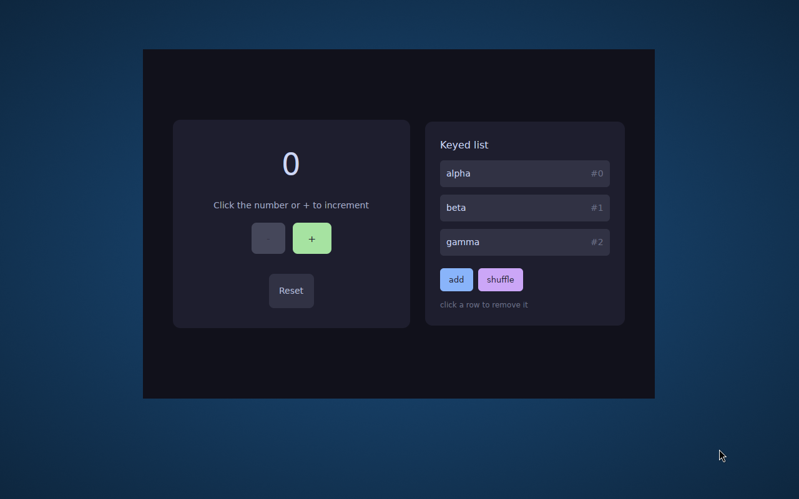
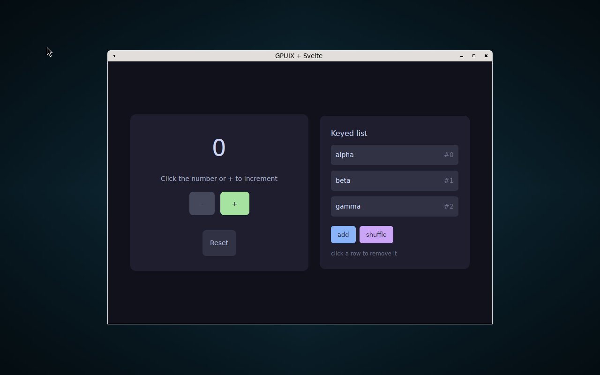

# No window decorations on GNOME / Wayland

A GPUI window has no title bar, and no close / minimise / maximise buttons, on GNOME —
which is Ubuntu's default session. The same binary is decorated normally on sway, labwc
and KDE, so the app looks broken only for GNOME users.

| | |
|---|---|
| Component | `gpuix-native` 0.7.0 (`packages/native`), `gpui_linux` Wayland backend |
| Affects | GNOME / Mutter (any version — Mutter implements no server-side decorations) |
| Verified on | Mutter 46.2, Ubuntu 24.04, wgpu/Vulkan via lavapipe |

## Actual — GNOME / Mutter 46.2



## Expected — the same build under labwc



Same component, same binary, same window size. The only variable is the compositor.

## Cause

gpuix never tells the compositor which decoration mode it wants, so the compositor's
default decides.

1. A window starts client-side decorated — `gpui_linux/src/linux/wayland/window.rs:612`,
   `decorations: WindowDecorations::Client`.
2. gpui creates a `zxdg_toplevel_decoration_v1` when the manager exists
   (`window.rs:279`) but **never calls `set_mode` on it**.
3. gpuix never calls `request_decorations` either. Its `WindowOptions.titlebar_transparent`
   feeds `gpui::TitlebarOptions`, which is the macOS titlebar and does nothing here.

With no `set_mode`, the protocol leaves the choice to the compositor:

```console
$ wayland-info | grep -i decoration      # labwc
interface: 'org_kde_kwin_server_decoration_manager', version: 1, name: 16
interface: 'zxdg_decoration_manager_v1',             version: 1, name: 17

$ wayland-info | grep -i decoration      # mutter 46.2
(no output — 26 globals, none of them a decoration manager)
```

sway / labwc / KDE advertise the manager and default to server-side, so they decorate the
window. Mutter advertises none, so `decoration` stays `None`, the window stays
`WindowDecorations::Client`, and since a gpuix view paints only the application's element
tree, nothing draws the chrome at all.

## Reproduce

From [gpuix-svelte](https://github.com/khromov/gpuix-svelte), which packages both sessions:

```bash
npm run linux:build
npm run linux:demo -- counter --gnome     # Mutter 46.2 — no title bar
npm run linux:demo -- counter --desktop   # labwc      — title bar with buttons
```

Both open the window at `http://localhost:6080`.

## Suggested fix

GNOME mandates client-side decorations; there is no server-side mode to switch on there.
So the application has to draw the bar, and gpuix has to make that possible and consistent:

1. **Expose `requestDecorations(mode)`.** `PlatformWindow::request_decorations` already
   maps to `set_mode` (`window.rs:2062`, `2228`). Calling it with `Client` also suppresses
   the server-side bar on sway / labwc / KDE — without that, an app that draws its own bar
   gets **two**.
2. **Report the negotiated mode back to the app.** The compositor's reply arrives at
   `handle_toplevel_decoration_event` (`window.rs:1135`) and need not match the request, so
   the app should draw its bar only when the result is `ClientSide`.
3. **Expose the window controls a title bar needs** — gpui has `minimize()`, `zoom()` and
   `start_window_move()` (`gpui/src/platform.rs:845-907`); none are bound in
   `@gpuix/native`'s `index.d.ts`. Without `start_window_move` a custom bar cannot drag the
   window, since on Wayland only the compositor may move it.

Worth noting for whoever implements it: `is_transparent()` returns true whenever
decorations are client-side (`window.rs:635`), so under CSD the window is transparent and
the app must paint its own background and corners. `client_inset` / `getWindowInsets` is
the related plumbing.
