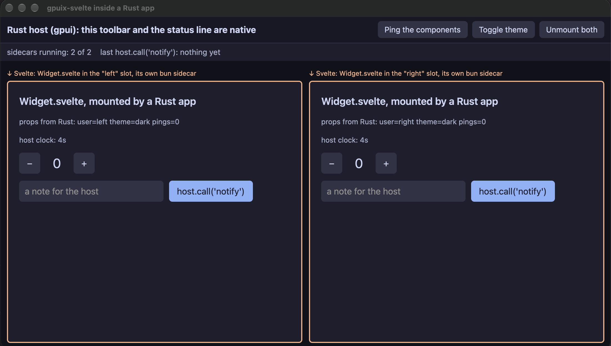

# Embedding in a Rust app

Everything else in these docs assumes gpuix-svelte owns the window: `render()` starts GPUI, opens
the window and drives its frame loop from Bun or Node. This page is the other way around. You
already have a Rust application built on GPUI, with its own `App`, windows and layout, and you want
a Svelte component in one part of it: a module in a status bar, a result list in a launcher, a
plugin a user wrote without recompiling your binary. The
[`gpuix-svelte-embed`](../crates/gpuix-svelte-embed) crate gives your app a `SvelteSlot`, a gpui
view like any other, and [`gpuix-svelte/embed`](../src/embed.ts) gives the component the host it
runs in.

It is a prototype: the API is small and will move, and it depends on three small
changes to `@gpuix/native` that are not upstream yet (see [Status](#status)).

## How it works

A slot spawns a **Bun sidecar** running your component entry through gpuix-svelte, exactly as
`gpuix-svelte widget.ts` would, except that the entry calls `embed()` instead of `render()`.
Nothing on the JS side loads `@gpuix/native`: the renderer's batches, the same JSON that
`applyBatch` would take, go up the sidecar's stdout, and the host applies them to a retained
element tree of its own with `gpuix-native`'s `apply_batch_to_tree`. The slot paints that tree with
`gpuix-native`'s `GpuixView`, the same element builder the napi window uses, inside whatever
layout you put the slot in. Pointer and keyboard events GPUI raises on those elements go back down
the sidecar's stdin, and the component's handlers run in the sidecar like in any gpuix-svelte app.

```
 your gpui App ──────────────────────────────┐    ┌── bun widget.ts ───────────────────────┐
 │  div().child(toolbar)                     │    │  embed(Widget)                         │
 │     .child(slot)  ← SvelteSlot            │    │    Svelte → renderer.ts → batches ─────┼─▶ stdout
 │        RetainedTree ◀── apply_batch ──────┼────┼─◀                                      │
 │        GpuixView paints it                │    │    dispatch(event) ◀───────────────────┼─◀ stdin
 │        events ─────────────────────────────┼───▶│                                        │
 │  slot.set_props / slot.emit ──────────────┼───▶│  $props() / host.on(name)              │
 │  slot.on_call(name, f) ◀──────────────────┼────┼─ host.call(name, ...args) → Promise    │
 └───────────────────────────────────────────┘    └────────────────────────────────────────┘
```

Each slot is its own sidecar and its own component instance, so two slots never share state, and
dropping the slot's entity ends its process. A Bun process costs a few tens of megabytes of memory,
which is the price of the isolation; a shared sidecar hosting several slots is possible behind the
same protocol but not written.

## The Rust side

The crate is not on crates.io: it links `gpuix-native` as a Rust library, and `gpuix-native`
itself builds from the [gpuix](https://github.com/remorses/gpuix) repository with its vendored
gpui. Until the embedding changes land there, point at the
[`feat/embed` branch of the fork](https://github.com/khromov/gpuix/tree/feat/embed) checked out
beside your project, and build your app with the same gpui that `gpuix-native` pins:

```toml
[dependencies]
gpuix-svelte-embed = { path = "../gpuix-svelte/crates/gpuix-svelte-embed" }
gpui = { path = "../gpuix/zed/crates/gpui", default-features = false }
gpui_platform = { path = "../gpuix/zed/crates/gpui_platform", default-features = false }
```

`gpuix-native`'s napi bindings compile in with it and reference `napi_*` symbols that only Node
provides. Nothing in your app calls them, so the binary links with them unresolved, the way a
`.node` addon does; copy [`examples/rust-host/build.rs`](../examples/rust-host/build.rs) into
your crate for the linker flag.

Then, in your app:

```rust
use gpuix_svelte_embed::{SlotOptions, SvelteSlot};
use serde_json::json;

fn main() {
    gpui_platform::application().run(|cx| {
        // Once per App: text field key bindings, and the HTTP client  uses.
        gpuix_svelte_embed::init(cx);
        cx.open_window(Default::default(), |_, cx| cx.new(|cx| Shell::new(cx))).unwrap();
    });
}

struct Shell { slot: Entity<SvelteSlot> }

impl Shell {
    fn new(cx: &mut Context<Self>) -> Self {
        let options = SlotOptions::bun("plugins/clock/widget.ts", "/path/to/the/plugin/project")
            .props(json!({ "format": "24h" }));
        let slot = SvelteSlot::spawn(options, cx).expect("bun is on PATH");
        slot.update(cx, |slot, _| {
            // `host.call('run', cmd)` in the component resolves with what this returns.
            slot.on_call("run", |args, _cx| {
                let command = args[0].as_str().unwrap_or("");
                Ok(json!({ "started": command }))
            });
        });
        Self { slot }
    }
}

impl Render for Shell {
    fn render(&mut self, _: &mut Window, _: &mut Context<Self>) -> impl IntoElement {
        div().flex().size_full()
            .child(div().w(px(240.)).child("native sidebar"))
            .child(div().flex_1().child(self.slot.clone()))
    }
}
```

- `SlotOptions::bun(entry, cwd)` runs `bun` with the conditions and loader Svelte's custom
  renderer needs, resolving `gpuix-svelte` from `cwd`'s `node_modules`. `SlotOptions { command,
  .. }` takes any program instead: `gpuix-svelte widget.ts`, or a binary a plugin author built with
  `Bun.build({ compile })` from an entry that calls `embed()`. That binary needs no `.node`.
- `slot.set_props(json!({...}))` replaces the component's `$props()`; `slot.emit(name, data)`
  reaches its `host.on(name)` subscribers; `slot.on_call(name, f)` answers `host.call(name,
  ...args)`, with `args` as a JSON array, on the UI thread and with the slot's `Context`, through
  which a `WeakEntity` of your own view is one `update` away. Those three are the whole host API,
  which is what [the issue that started this](https://github.com/khromov/gpuix-svelte/issues/48)
  asked for: a way for JS to call Rust and for Rust to send events to JS.
- Dropping the `Entity<SvelteSlot>` closes the sidecar's stdin, which unmounts the component and
  exits the process. `is_running()` turns false if it exits on its own, and the slot then paints a
  one-line notice where the component was; mount again by spawning a new slot.
- `RUST_LOG=gpuix_svelte_embed=debug` logs every batch, call and host message if your app
  installs a `log` backend such as `env_logger`.

## The JS side

The entry is three lines, and the component is an ordinary gpuix-svelte component: the same tags,
styling, `<style>` rules, `set_css_vars`, shipped components and events as in a window of its own.

```ts
import { embed } from 'gpuix-svelte/embed';
import Widget from './Widget.svelte';

embed(Widget);
```

```svelte
<script lang="ts">
	import { host } from 'gpuix-svelte/embed';

	// Whatever the host passed in `SlotOptions::props`, re-rendered on every `set_props`.
	let { format = '12h' }: { format?: string } = $props();

	let now = $state('');
	$effect(() => host.on('tick', (data) => (now = (data as { time: string }).time)));

	async function open() {
		const answer = await host.call('run', 'gnome-calendar');
	}
</script>

<div class="clock" onclick={open}><text>{now} ({format})</text></div>
```

- `host.call(name, ...args)` returns a promise; it rejects with the host's error, or with "the
  host has no function named …". `host.on(name, handler)` returns the unsubscribe, so returning it
  from an `$effect` ties it to the component. `host.props` is the same object `$props()` reads,
  for code outside the component.
- `embed()` throws unless the process was started by a host (`GPUIX_EMBED=1`). `console.log`,
  `info` and `debug` go to stderr, because stdout is the wire; the host inherits stderr.
- There is no window: `set_window_title`, the picker, focus and image helpers in
  `gpuix-svelte` no-op as they do under any native without the method, Tab moves no focus, and
  `window_size` reports the fallback. `getElementBounds` is answered by the host (so `{@attach}`
  measurement works); the scroll offset reads `Scroller` makes are not yet, so a `Scroller` in a
  slot scrolls but draws no thumb.
- No hot reload inside a slot: `render_hot` is a window's feature. Unmount and mount the slot from
  the host to pick up a changed component, or `GPUIX_SVELTE_RENDERER` and a compiled plugin.

## The demo

[`examples/rust-host`](../examples/rust-host) is a gpui app with a native toolbar and status line
above two `SvelteSlot`s, each running [`Widget.svelte`](../examples/rust-host/Widget.svelte) in a
sidecar of its own, so their counters and state never touch. The orange frames are drawn by the
host; everything inside one is the sidecar's. The toolbar's buttons push new props (a ping counter
and a theme the widgets read for their palette) and mount or unmount both slots; the host emits a
`tick` every second that the widgets show; a widget's `host.call('notify', text)` lands in the
host's status line, named after the slot it came from, and resolves with the host's uptime.



```bash
npm run demo:embed      # cargo run -p gpuix-svelte-rust-host
```

It needs Rust (the repo's `rust-toolchain.toml` pins the version zed's gpui wants), Bun on
`PATH`, and the gpuix fork checked out at `../gpuix` on its `feat/embed` branch with the `zed`
submodule, which is also where the build's `target/` goes. On macOS the gpui build compiles
Metal shaders with Xcode's `metal` tool; if `xcode-select -p` points at the Command Line Tools,
run it with `DEVELOPER_DIR=/Applications/Xcode.app/Contents/Developer`. The first build is long;
later ones are seconds.

## The wire

For a host in another language, or a sidecar that is not Bun: one message per line, UTF-8,
`<kind> <id> <json>`, where `id` is `0` for a message nobody answers.

| direction | kind | json | answered |
| --- | --- | --- | --- |
| sidecar → host (stdout) | `batch` | the `applyBatch` array | on the FIFO: `ok <id> [destroyed ids]` or `err <id> "message"` |
| sidecar → host | `query` | `{"q":"bounds","args":[id]}` | on the FIFO: `ok <id> {x,y,width,height}` or `null` |
| sidecar → host | `call` | `{"name":"...","args":[...]}` | on stdin: `reply <id> {"ok":...}` or `{"err":"..."}` |
| host → sidecar (stdin) | `init` | the initial props | mounts the component |
| host → sidecar | `event` | an `EventPayload`, camelCase | |
| host → sidecar | `props` | the new props | |
| host → sidecar | `emit` | `{"name":"...","data":...}` | |
| host → sidecar | EOF | | unmounts and exits |

The renderer needs a batch's answer before it continues, so the host opens a FIFO (on Windows an
outbound named pipe, `\\.\pipe\...`, which the sidecar opens read-only), passes its path as
`GPUIX_EMBED_REPLY`, and the sidecar reads answers from it with a blocking read. The host
also sets `GPUIX_EMBED=1` and `GPUIX_EMBED_ID_BASE`: each slot numbers its elements from its own
2^32 range, because the bounds GPUI records at paint time are keyed by element id for the whole
process. [`test/embed.ts`](../test/embed.ts) is a host written in TypeScript against this table, and
is what `npm test` runs.

## Status

- The three `@gpuix/native` changes the crate needs are on the fork's `feat/embed` branch and
  small: `GpuixView` and its constructor become public, its window title becomes optional so an
  embedded view never renames the host's window, `EventPayload` serializes on desktop targets, and
  `init(cx)` / `painted_bounds(id)` are exported for a host that has no `GpuixRenderer`.
- Linux is the target the request came from and is untested here; the link flag that lets the
  binary carry unresolved `napi_*` symbols is in `build.rs` for both platforms.
- Keyboard: elements with `onkeydown` and `tabindex` work, but window-level key events
  (`on_window_key`) and Tab navigation need the host to forward `setWindowKeyEvents`, which it does
  not yet.
