# UI toolkit

![Orbit, a small deployment dashboard built from the toolkit, in a GPUI window: a sidebar with the Orbit logo, a Pro badge, Overview, Deployments and a selected Settings link, key caps for back and forward and Ada Lovelace's account; the Settings screen with Discard and Save changes buttons, General, Members and a dimmed Billing tab, a Project card with Name, Region and Description fields, a Builds card with two toggles, a checkbox, a Node.js radio group with an info button and a Concurrent builds slider, a Danger zone card with a Delete project button, and a Settings saved toast in the corner.](assets/ui-app.png)

> [!NOTE]
> **Not released yet.** `gpuix-svelte-ui` ships alongside the next gpuix-svelte release (0.6.0),
> which is the first with the [DOM build](dom.md) it needs.

`gpuix-svelte-ui` is a set of components written once for both renderers: a native window through
gpuix-svelte, and a browser DOM through Vite or SvelteKit. Buttons, fields, choices, menus, dialogs,
toasts, a few layout and feedback pieces, a router for the screens of an app, and the theme behind
them. The window above is [`examples/ui-app`](../examples/ui-app/App.svelte), a small app built
from most of them (`npm run demo:ui-app` in the repository). Every component has a section of its
own below, with a sample that runs live on this page, in the DOM, and a picture of the same sample
in a GPUI window above it. `npm run demo:ui` opens the showcase, every component on one screen, in
a GPUI window, and `npm run demo:ui-dom` serves it as a page.

## Setup

```sh
npm install gpuix-svelte gpuix-svelte-ui
```

```svelte
<script>
  import { Button, Card, apply_theme } from 'gpuix-svelte-ui';

  $effect(() => apply_theme('dark'));
</script>

<Card title="Hello">
  <Button variant="primary" onclick={() => console.log('clicked')}>Click me</Button>
</Card>
```

Every component reads its colours from `--ui-*` tokens, and `apply_theme()` puts a palette in force
on either renderer: through `set_css_vars` on GPUI, as custom properties on `:root` in a browser.
Call it from an `$effect` at the root, before anything paints, so no token is missing on the first
frame. The components themselves resolve through the package's own exports, so
`gpuix-svelte-ui/components/Button.svelte` is the same file as `Button` from the barrel.

In a GPUI app nothing else is needed. A page wants a stylesheet with what a window gives for
free: `* { box-sizing: border-box }`, a font, `input, textarea { font: inherit }` so the fields
take it too, and `body { margin: 0 }` (`render()` sets the last one; see
[`packages/ui/showcase/index.html`](../packages/ui/showcase/index.html)). A prerendered SvelteKit
page can carry the palette before any effect runs:

```svelte
<script>
  import { DARK, theme_rule } from 'gpuix-svelte-ui';
</script>

<svelte:head>
  {@html `<style>${theme_rule(DARK)}</style>`}
</svelte:head>
```

The components are typed as GPUI markup, so an app that ships to both targets typechecks them
with the GPUI project's `tsconfig`, as [DOM](dom.md#writing-a-component-for-both) explains;
`svelte-check` on a SvelteKit side types them as DOM markup, which they pass too.

## Theme

`apply_theme(palette)` takes `'dark'`, `'light'` or a `Palette` of your own. `DARK` and `LIGHT`
are the two it ships, and `theme.palette` is the one in force, reactive, for the odd place that
needs a value in JavaScript (`TextField` hands GPUI's input a theme object rather than CSS).

| Token | What it colours |
| --- | --- |
| `bg`, `panel`, `raised`, `raised-hover` | the window, cards and dialogs, badges and hovered rows |
| `border`, `border-strong` | hairlines and control outlines |
| `ink`, `muted` | text |
| `accent`, `accent-ink`, `accent-wash`, `on-accent` | the brand colour, its legible text, a translucent wash, text on it |
| `success`, `warning`, `danger`, each with a `-wash` | tones for badges, toasts and progress |

Each is a `--ui-<token>` custom property, so your own markup can read `var(--ui-accent)` next to
the components, and `theme_vars(palette)` is the full map should you want to set them yourself.
The same call sets the tokens gpuix-svelte's own `Tooltip`, `Popover` and `Scroller` read.

The button below switches the palette, and since the tokens are global, every sample on this
page follows it.

```svelte demo theme
<script>
  import { Button, Badge, apply_theme, theme } from 'gpuix-svelte-ui';

  let dark = $state(true);
  $effect(() => apply_theme(dark ? 'dark' : 'light'));
</script>

<div class="row">
  <Button onclick={() => (dark = !dark)}>{dark ? 'Light' : 'Dark'} theme</Button>
  <Badge tone="accent">{theme.palette.appearance}</Badge>
  <div class="note">accent is {theme.palette.accent}</div>
</div>

<style>
  .row { display: flex; flex-wrap: wrap; align-items: center; gap: 10px; }
  .note { font-size: 13px; color: var(--ui-muted); }
</style>
```

## Buttons, badges and keys

### Button

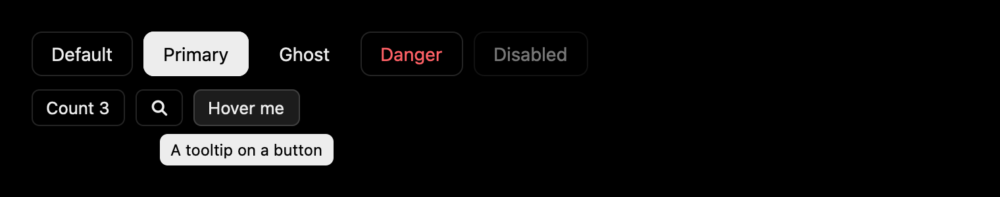

`Button` is a focusable box: Enter and Space press it, `variant` is `default`, `primary`, `ghost`
or `danger`, `size` is `md` or `sm`, and `disabled` takes it out of the tab order. `label` names a
button whose content is an icon. It spreads `onmouseenter` / `onmouseleave`, which is what lets a
`Tooltip` wrap it, and `onfocus` / `onblur`, so a tip given `{...focus}` too shows on keyboard
focus.

```svelte demo button
<script>
  import { Button, Icon, Tooltip } from 'gpuix-svelte-ui';

  let count = $state(0);
</script>

<div class="row">
  <Button>Default</Button>
  <Button variant="primary">Primary</Button>
  <Button variant="ghost">Ghost</Button>
  <Button variant="danger">Danger</Button>
  <Button disabled>Disabled</Button>
</div>
<div class="row">
  <Button size="sm" onclick={() => count++}>Count {count}</Button>
  <Button size="sm" label="Search"><Icon name="search" size={14} /></Button>
  <Tooltip content="A tooltip on a button" side="bottom">
    {#snippet children(hover, focus)}
      <Button {...hover} {...focus} size="sm">Hover me</Button>
    {/snippet}
  </Tooltip>
</div>

<style>
  .row { display: flex; flex-wrap: wrap; align-items: center; gap: 8px; margin-bottom: 10px; }
</style>
```

### Badge

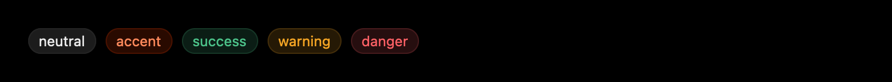

`Badge` is a short label in a pill, coloured by its `tone`: `neutral` (the default), `accent`,
`success`, `warning` or `danger`, the same tones `Progress` and the toasts take.

```svelte demo badge
<script>
  import { Badge } from 'gpuix-svelte-ui';
</script>

<div class="row">
  <Badge>neutral</Badge>
  <Badge tone="accent">accent</Badge>
  <Badge tone="success">success</Badge>
  <Badge tone="warning">warning</Badge>
  <Badge tone="danger">danger</Badge>
</div>

<style>
  .row { display: flex; flex-wrap: wrap; align-items: center; gap: 8px; }
</style>
```

### Kbd

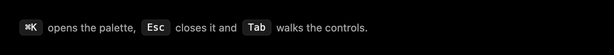

`Kbd` draws its content as a key cap, for a shortcut written into a sentence.

```svelte demo kbd
<script>
  import { Kbd } from 'gpuix-svelte-ui';
</script>

<div class="row">
  <Kbd>⌘K</Kbd>
  <div class="note">opens the palette,</div>
  <Kbd>Esc</Kbd>
  <div class="note">closes it and</div>
  <Kbd>Tab</Kbd>
  <div class="note">walks the controls.</div>
</div>

<style>
  .row { display: flex; flex-wrap: wrap; align-items: center; gap: 6px; }
  .note { font-size: 13px; color: var(--ui-muted); }
</style>
```

### Icon

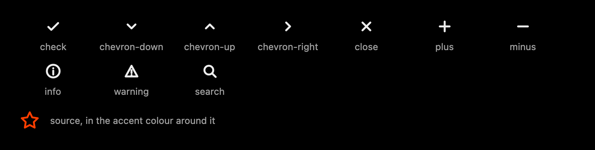

`Icon` draws one of the toolkit's glyphs by `name`, or any SVG markup through `source`, `size`
pixels square in the colour of the text around it. `ICONS` holds the glyphs by name, as markup.

```svelte demo icon
<script>
  import { ICONS, Icon } from 'gpuix-svelte-ui';

  const STAR = '<svg xmlns="http://www.w3.org/2000/svg" viewBox="0 0 24 24" fill="none" stroke="currentColor" stroke-width="2" stroke-linejoin="round"><path d="M12 3l2.7 5.6 6.1.9-4.4 4.3 1 6.1L12 17l-5.4 2.9 1-6.1-4.4-4.3 6.1-.9z"/></svg>';
</script>

<div class="row">
  {#each Object.keys(ICONS) as name}
    <div class="cell">
      <Icon {name} size={20} />
      <div class="name">{name}</div>
    </div>
  {/each}
</div>
<div class="row">
  <div class="accent"><Icon source={STAR} size={28} /></div>
  <div class="name">source, in the accent colour around it</div>
</div>

<style>
  .row { display: flex; flex-wrap: wrap; align-items: center; gap: 12px; margin-bottom: 14px; }
  .cell { display: flex; flex-direction: column; align-items: center; gap: 6px; min-width: 88px; }
  .name { font-size: 12px; color: var(--ui-muted); }
  .accent { display: flex; color: var(--ui-accent); }
</style>
```

## Cards, layout and feedback

### Card

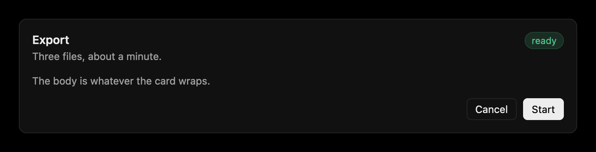

`Card` holds a `title`, a `description`, an `actions` snippet at the right of the title, the body
and a `footer` snippet; `pad` and `gap` space it out.

```svelte demo card
<script>
  import { Badge, Button, Card } from 'gpuix-svelte-ui';
</script>

<Card title="Export" description="Three files, about a minute.">
  {#snippet actions()}
    <Badge tone="success">ready</Badge>
  {/snippet}
  <div class="note">The body is whatever the card wraps.</div>
  {#snippet footer()}
    <Button size="sm">Cancel</Button>
    <Button size="sm" variant="primary">Start</Button>
  {/snippet}
</Card>

<style>
  .note { font-size: 13px; color: var(--ui-muted); }
</style>
```

### Stack

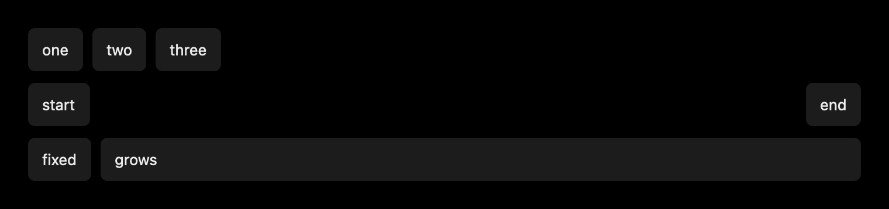

`Stack` is a flex box with its spacing as props (`direction`, `gap`, `align`, `justify`, `wrap`,
`pad`, `grow`), in the names both renderers know (`start` and `end`, not `flex-start`).

```svelte demo stack
<script>
  import { Stack } from 'gpuix-svelte-ui';
</script>

<Stack gap={10}>
  <Stack direction="row" gap={8}>
    <div class="box">one</div>
    <div class="box">two</div>
    <div class="box">three</div>
  </Stack>
  <Stack direction="row" justify="space-between">
    <div class="box">start</div>
    <div class="box">end</div>
  </Stack>
  <Stack direction="row" gap={8}>
    <div class="box">fixed</div>
    <Stack grow={1}><div class="box">grows</div></Stack>
  </Stack>
</Stack>

<style>
  .box { padding: 8px 12px; border-radius: 6px; background-color: var(--ui-raised); font-size: 13px; }
</style>
```

### Separator

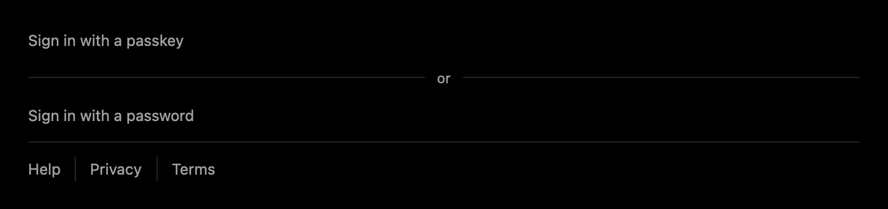

`Separator` is a hairline across, or between the items of a row with `direction="vertical"`, and
an optional `label` sits in the middle of it.

```svelte demo separator
<script>
  import { Separator } from 'gpuix-svelte-ui';
</script>

<div class="column">
  <div class="note">Sign in with a passkey</div>
  <Separator label="or" />
  <div class="note">Sign in with a password</div>
  <Separator />
  <div class="row">
    <div class="note">Help</div>
    <Separator direction="vertical" />
    <div class="note">Privacy</div>
    <Separator direction="vertical" />
    <div class="note">Terms</div>
  </div>
</div>

<style>
  .column { display: flex; flex-direction: column; gap: 12px; }
  .row { display: flex; gap: 12px; }
  .note { font-size: 13px; color: var(--ui-muted); }
</style>
```

### Progress

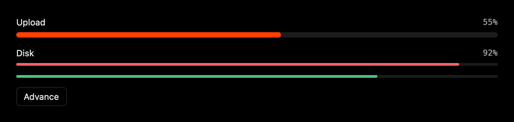

`Progress` draws `value` out of `max` (100 by default) in a `tone`, with an optional `label` and,
with `show_value`, the percentage beside it; `size` is `md` or `sm`.

```svelte demo progress
<script>
  import { Button, Progress } from 'gpuix-svelte-ui';

  let upload = $state(35);
</script>

<div class="column">
  <Progress value={upload} label="Upload" show_value />
  <Progress value={92} tone="danger" label="Disk" show_value size="sm" />
  <Progress value={3} max={4} tone="success" size="sm" />
  <div class="row">
    <Button size="sm" onclick={() => (upload = upload >= 100 ? 0 : Math.min(100, upload + 20))}>Advance</Button>
  </div>
</div>

<style>
  .column { display: flex; flex-direction: column; gap: 14px; }
  .row { display: flex; }
</style>
```

### Spinner

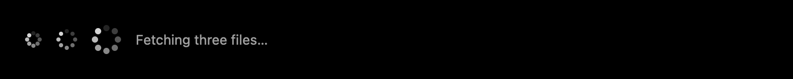

`Spinner` turns while something loads, `size` pixels across; `label` is what a screen reader
announces (`Loading` by default).

```svelte demo spinner
<script>
  import { Spinner } from 'gpuix-svelte-ui';
</script>

<div class="row">
  <Spinner size={16} />
  <Spinner />
  <Spinner size={28} label="Fetching files" />
  <div class="note">Fetching three files…</div>
</div>

<style>
  .row { display: flex; align-items: center; gap: 14px; }
  .note { font-size: 13px; color: var(--ui-muted); }
</style>
```

### Skeleton

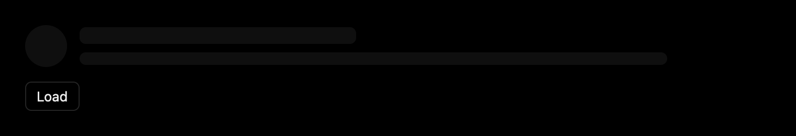

`Skeleton` is a pulsing placeholder for content still loading: `width` in pixels or as CSS text
such as `60%`, `height` and `radius`.

```svelte demo skeleton
<script>
  import { Avatar, Button, Skeleton, Stack } from 'gpuix-svelte-ui';

  let loaded = $state(false);
</script>

<Stack direction="row" gap={12} align="center">
  {#if loaded}
    <Avatar name="Ada Lovelace" size={40} />
    <Stack gap={4} grow={1}>
      <div>Ada Lovelace</div>
      <div class="note">Wrote the first program, in 1843.</div>
    </Stack>
  {:else}
    <Skeleton width={40} height={40} radius={20} />
    <Stack gap={8} grow={1}>
      <Skeleton width="40%" />
      <Skeleton width="85%" height={12} />
    </Stack>
  {/if}
</Stack>
<div class="row">
  <Button size="sm" onclick={() => (loaded = !loaded)}>{loaded ? 'Unload' : 'Load'}</Button>
</div>

<style>
  .note { font-size: 13px; color: var(--ui-muted); }
  .row { display: flex; margin-top: 14px; }
</style>
```

### Avatar

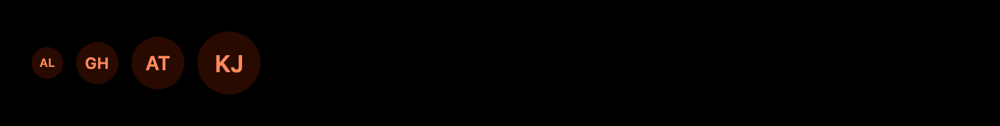

`Avatar` shows the image at `src` (a path, a `data:` URL or an http(s) URL on GPUI, any image URL
in a browser) and the initials of `name` until it has one, `size` pixels across.

```svelte demo avatar
<script>
  import { Avatar } from 'gpuix-svelte-ui';
</script>

<div class="row">
  <Avatar name="Ada Lovelace" size={24} />
  <Avatar name="Grace Hopper" />
  <Avatar name="Alan Turing" size={40} />
  <Avatar name="Katherine Johnson" size={48} />
</div>

<style>
  .row { display: flex; align-items: center; gap: 10px; }
</style>
```

## Fields

### TextField

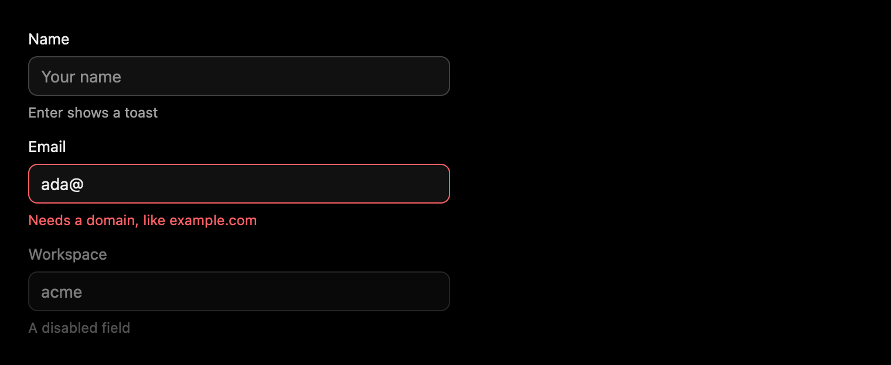

`TextField` wraps a real input: `value` in, `onchange(value)` on every edit, and `onsubmit(value)`
on Enter. It is controlled, so keep `value` in your state. `label`, `hint` and `error` go around
the box, `error` also colouring it, and a `disabled` field takes no focus, click or Enter on
either renderer. On GPUI the input is native and draws its text from the palette `apply_theme`
set.

```svelte demo textfield
<script>
  import { TextField, toast } from 'gpuix-svelte-ui';

  let name = $state('');
  let email = $state('ada@');
</script>

<div class="column">
  <TextField value={name} onchange={(v) => (name = v)} onsubmit={(v) => toast(`Hello, ${v || 'stranger'}`)} label="Name" placeholder="Your name" hint="Enter shows a toast" />
  <TextField value={email} onchange={(v) => (email = v)} label="Email" error={email.includes('.') ? null : 'Needs a domain, like example.com'} />
  <TextField value="acme" onchange={() => {}} label="Workspace" hint="A disabled field" disabled />
</div>

<style>
  .column { display: flex; flex-direction: column; gap: 12px; max-width: 360px; }
</style>
```

### TextArea

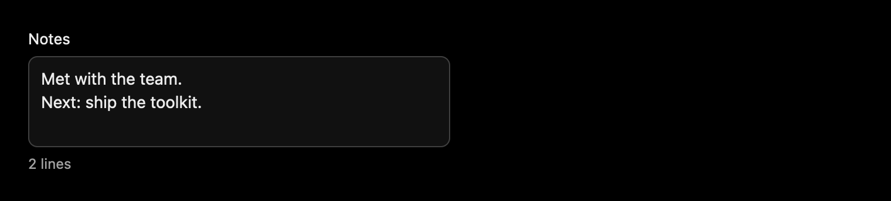

`TextArea` takes the same props for more than one line, and `rows` for its height. On GPUI it
grows from `rows` up to `max_rows` as the text does, and Enter inserts a newline unless
`onsubmit` is set, when Shift+Enter still does.

```svelte demo textarea
<script>
  import { TextArea } from 'gpuix-svelte-ui';

  let notes = $state('Met with the team.\nNext: ship the toolkit.');
</script>

<div class="column">
  <TextArea value={notes} onchange={(v) => (notes = v)} label="Notes" placeholder="A few lines" rows={3} max_rows={6} hint="{notes.split('\n').length} lines" />
</div>

<style>
  .column { display: flex; flex-direction: column; max-width: 360px; }
</style>
```

### Select

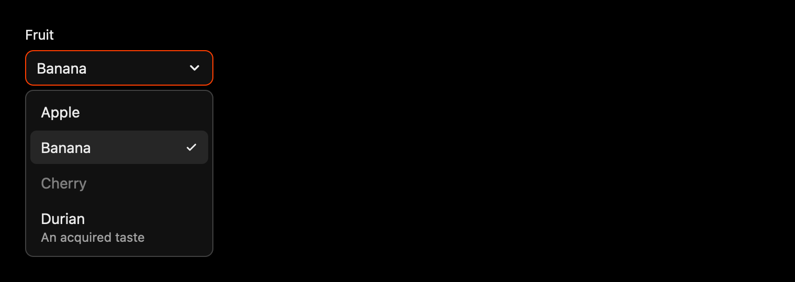

`Select` is a trigger and a list in a `Popover`: `options` are `{ value, label, disabled?,
description? }`, `value` is the chosen one or `null`, and arrows, Enter and Escape work on the
trigger.

```svelte demo select
<script>
  import { Select } from 'gpuix-svelte-ui';

  let fruit = $state(null);
  const FRUITS = [
    { value: 'apple', label: 'Apple' },
    { value: 'banana', label: 'Banana' },
    { value: 'cherry', label: 'Cherry', disabled: true },
    { value: 'durian', label: 'Durian', description: 'An acquired taste' }
  ];
</script>

<div class="column">
  <Select options={FRUITS} value={fruit} onchange={(v) => (fruit = v)} label="Fruit" placeholder="Pick one" />
  <div class="note">{fruit ? `Picked ${fruit}.` : 'Nothing picked yet.'}</div>
</div>

<style>
  .column { display: flex; flex-direction: column; gap: 12px; max-width: 360px; }
  .note { font-size: 13px; color: var(--ui-muted); }
</style>
```

## Choices and ranges

### Toggle

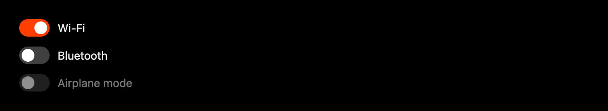

`Toggle` is a switch: `checked` and `onchange(checked)`, with a `label` beside it, and `disabled`
takes it out of the tab order.

```svelte demo toggle
<script>
  import { Toggle } from 'gpuix-svelte-ui';

  let wifi = $state(true);
  let bluetooth = $state(false);
</script>

<div class="column">
  <Toggle checked={wifi} onchange={(v) => (wifi = v)} label="Wi-Fi" />
  <Toggle checked={bluetooth} onchange={(v) => (bluetooth = v)} label="Bluetooth" />
  <Toggle checked={false} onchange={() => {}} label="Airplane mode" disabled />
</div>

<style>
  .column { display: flex; flex-direction: column; gap: 12px; }
</style>
```

### Checkbox

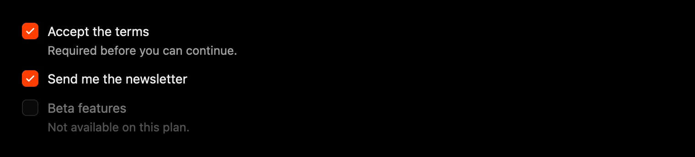

`Checkbox` takes `checked` and `onchange(checked)` too, with a `label` and a `description` under
it.

```svelte demo checkbox
<script>
  import { Checkbox } from 'gpuix-svelte-ui';

  let terms = $state(false);
  let news = $state(true);
</script>

<div class="column">
  <Checkbox checked={terms} onchange={(v) => (terms = v)} label="Accept the terms" description="Required before you can continue." />
  <Checkbox checked={news} onchange={(v) => (news = v)} label="Send me the newsletter" />
  <Checkbox checked={false} onchange={() => {}} label="Beta features" description="Not available on this plan." disabled />
</div>

<style>
  .column { display: flex; flex-direction: column; gap: 12px; }
</style>
```

### RadioGroup

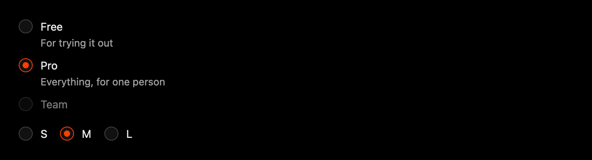

`RadioGroup` picks one of its `options` (`{ value, label, description?, disabled? }`): `value`
and `onchange(value)`, a `label` that names the group to a screen reader, and `direction="row"` to
set the options side by side. The arrow keys move the selection and skip a disabled option.

```svelte demo radiogroup
<script>
  import { RadioGroup } from 'gpuix-svelte-ui';

  let plan = $state('pro');
  let size = $state('m');
</script>

<div class="column">
  <RadioGroup
    options={[
      { value: 'free', label: 'Free', description: 'For trying it out' },
      { value: 'pro', label: 'Pro', description: 'Everything, for one person' },
      { value: 'team', label: 'Team', disabled: true }
    ]}
    value={plan}
    onchange={(v) => (plan = v)}
    label="Plan"
  />
  <RadioGroup options={[{ value: 's', label: 'S' }, { value: 'm', label: 'M' }, { value: 'l', label: 'L' }]} value={size} onchange={(v) => (size = v)} label="Size" direction="row" />
</div>

<style>
  .column { display: flex; flex-direction: column; gap: 18px; }
</style>
```

### Tabs

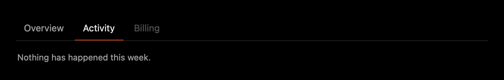

`Tabs` is a row of tabs over `items` of `{ value, label, disabled? }`, with `value` and
`onchange(value)`; the panel under it is yours to render. The arrow keys move between tabs and
skip a disabled one, and only the selected tab is a tab stop (the first enabled one while `value`
names none).

```svelte demo tabs
<script>
  import { Tabs } from 'gpuix-svelte-ui';

  let tab = $state('overview');
</script>

<Tabs items={[{ value: 'overview', label: 'Overview' }, { value: 'activity', label: 'Activity' }, { value: 'billing', label: 'Billing', disabled: true }]} value={tab} onchange={(v) => (tab = v)} />
<div class="panel">
  {#if tab === 'overview'}
    Three projects, one of them shared.
  {:else}
    Nothing has happened this week.
  {/if}
</div>

<style>
  .panel { padding: 14px 2px 0; font-size: 13px; color: var(--ui-muted); }
</style>
```

### Slider

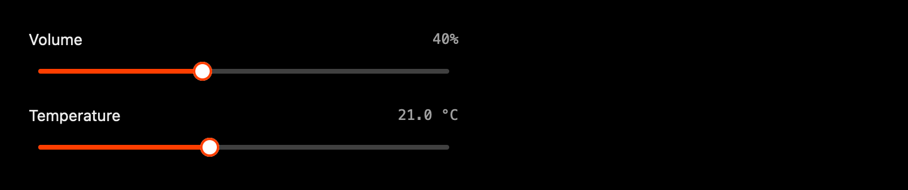

`Slider` takes `value`, `min`, `max`, `step` and `onchange(value)`: drag it, past the window's
edge too, click the track, or use the arrows, Home and End. `format` prints the readout beside its
`label`.

```svelte demo slider
<script>
  import { Slider } from 'gpuix-svelte-ui';

  let volume = $state(40);
  let heat = $state(21);
</script>

<div class="column">
  <Slider value={volume} onchange={(v) => (volume = v)} label="Volume" format={(v) => `${v}%`} />
  <Slider value={heat} onchange={(v) => (heat = v)} min={16} max={28} step={0.5} label="Temperature" format={(v) => `${v.toFixed(1)} °C`} />
</div>

<style>
  .column { display: flex; flex-direction: column; gap: 16px; max-width: 360px; }
</style>
```

## Menus, dialogs and toasts

### Menu

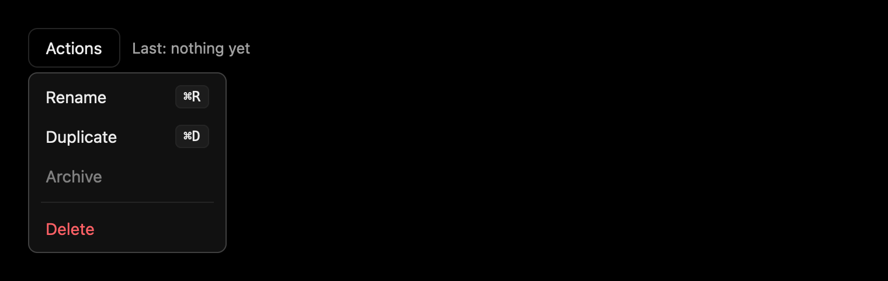

`Menu` is a `Popover` with `items`: `{ label, onselect, disabled?, danger?, shortcut? }`, or
`{ separator: true }`. You own `open`, the trigger toggles it, and an item that runs closes it, as
does a press outside or Escape. `position` opens it at a point instead of beside the trigger, for
a context menu.

```svelte demo menu
<script>
  import { Button, Menu } from 'gpuix-svelte-ui';

  let open = $state(false);
  let last = $state('nothing yet');
</script>

<div class="row">
  <Menu
    {open}
    onclose={() => (open = false)}
    items={[
      { label: 'Rename', shortcut: '⌘R', onselect: () => (last = 'Rename') },
      { label: 'Duplicate', shortcut: '⌘D', onselect: () => (last = 'Duplicate') },
      { label: 'Archive', disabled: true },
      { separator: true },
      { label: 'Delete', danger: true, onselect: () => (last = 'Delete') }
    ]}
  >
    <Button onclick={() => (open = !open)}>Actions</Button>
  </Menu>
  <div class="note">Last: {last}</div>
</div>

<style>
  .row { display: flex; align-items: center; gap: 10px; }
  .note { font-size: 13px; color: var(--ui-muted); }
</style>
```

### Dialog

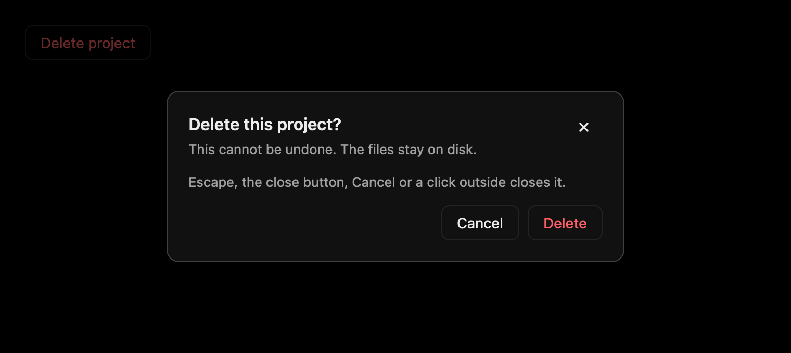

`Dialog` paints a scrim and a panel in a `Portal`: `open`, `onclose`, `title`, `description`, the
body and an `actions` snippet; `size` is `sm`, `md` or `lg`. Escape, the close button and a click
on the scrim call `onclose`, unless `dismissable` is false. Escape closes one overlay per press,
the one on top: a `Select`, `Menu`, `Popover` or `Tooltip` open inside a `Dialog` goes first, and
an overlay of your own joins the same stack through
[`dismiss_layer`](guide.md#keyboard-shortcuts-and-focus). Neither `Dialog` nor `Menu` moves
keyboard focus into itself yet, so Tab still walks the controls behind a dialog.

```svelte demo dialog
<script>
  import { Button, Dialog, toast } from 'gpuix-svelte-ui';

  let open = $state(false);
</script>

<div class="row">
  <Button variant="danger" onclick={() => (open = true)}>Delete project</Button>
</div>

<Dialog {open} onclose={() => (open = false)} title="Delete this project?" description="This cannot be undone. The files stay on disk.">
  <div class="note">Escape, the close button, Cancel or a click outside closes it.</div>
  {#snippet actions()}
    <Button onclick={() => (open = false)}>Cancel</Button>
    <Button variant="danger" onclick={() => { open = false; toast({ title: 'Project deleted', tone: 'danger' }); }}>Delete</Button>
  {/snippet}
</Dialog>

<style>
  .row { display: flex; }
  .note { font-size: 13px; color: var(--ui-muted); }
</style>
```

### Toaster

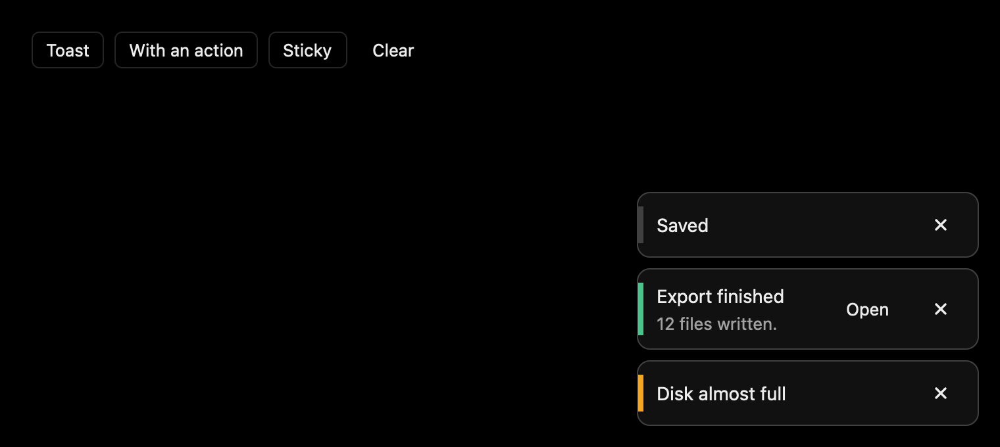

`toast('Saved')` or `toast({ title, description, tone, duration, action })` queues a toast from
anywhere, and a `<Toaster>` rendered once, at any `position`, shows the queue (this page's is the
one in the sample below, which shows the other samples' toasts too). A toast goes by itself after
`duration` ms (4000 by default; `null` keeps it) or when dismissed, and `dismiss_toast(id)` /
`clear_toasts()` do that from code.

```svelte demo toaster
<script>
  import { Button, Toaster, clear_toasts, toast } from 'gpuix-svelte-ui';
</script>

<div class="row">
  <Button size="sm" onclick={() => toast('Saved')}>Toast</Button>
  <Button size="sm" onclick={() => toast({ title: 'Export finished', description: '12 files written.', tone: 'success', action: { label: 'Open', onclick: () => toast('Opened') } })}>With an action</Button>
  <Button size="sm" onclick={() => toast({ title: 'Disk almost full', tone: 'warning', duration: null })}>Sticky</Button>
  <Button size="sm" variant="ghost" onclick={clear_toasts}>Clear</Button>
</div>
<Toaster />

<style>
  .row { display: flex; flex-wrap: wrap; align-items: center; gap: 8px; }
</style>
```

## Screens and routing

### Router

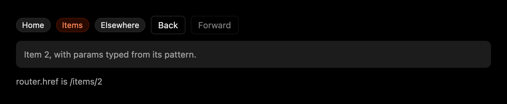

`Router` switches between screens by path, with a history stack behind it. In a window the stack
is in memory, and a hot reload keeps the current screen; in a page the stack is the browser's, so
the address bar, back and forward and deep links work (`mode="history"`, the default, or
`mode="hash"` for a static host that cannot rewrite every URL to `index.html`; `mode="memory"`
leaves the URL alone). A page served below the root, such as `/repo/` on GitHub Pages, sets
`base="/repo"`: it is stripped before matching and put back on every URL.

The table maps patterns to screens. A `:param` segment matches one segment, a trailing `/*` the
rest of the path (as `params['*']`, below any pattern that names those segments), and a bare `*`
whatever nothing else does. Where two patterns fit, the one with a literal at the earliest
position where they differ wins, so `/items/new` beats `/items/:id` in any order. A screen is a
component receiving `params` and `query` props, `screen(snippet)` for an app small enough to keep
its screens in one file, or `lazy(() => import('./Settings.svelte'))` for one imported on its first
visit (a failed import is logged and tried again next time).

A screen mounts fresh when the path changes; a change of query or hidden `state` alone hands the
same screen new props, so a search field that writes `?q=` as you type keeps its focus. State that
should survive a round trip lives in a module or in that `state`. A `#fragment` is the browser's
and never part of the route: in history mode a deep link keeps it, `navigate('/items#top')` puts it
in the address bar, and a plain `<a href="#section">` on a screen scrolls without navigating.

```svelte
<script>
  import { Router } from 'gpuix-svelte-ui';
  import Sidebar from './Sidebar.svelte';
  import Home from './Home.svelte';
  import Item from './Item.svelte';
  import NotFound from './NotFound.svelte';
</script>

<Router routes={{ '/': Home, '/items/:id': Item, '*': NotFound }} initial="/">
  {#snippet layout(content, route)}
    <Sidebar current={route.path} />
    {@render content()}
  {/snippet}
</Router>
```

- `navigate(path, { replace, state })`, `back()` and `forward()` do the same from code.
  A path resolves as a link on the current page would, so `edit`, `../list` and `?page=2` work,
  and a navigation to the route already shown replaces it rather than stacking a second entry.
  `navigate()` resolves to whether it arrived; with synchronous hooks it already has when it
  returns.
- `router.path`, `router.params`, `router.query`, `router.state`, `router.can_go_back` and
  `router.can_go_forward` are reactive wherever they are read, and `router.search` is the query as
  `URLSearchParams`, for a key that repeats (`router.search.getAll('tag')`).
- `href('/items/:id', { id: 3 }, { tag: ['a', 'b'] })` builds a path with its params typed from
  the pattern, plus an optional query whose arrays repeat their key.
- `before((to, from) => …)` runs before every navigation (a Link, `navigate()`, the keyboard, the
  browser's buttons and the first screen alike): `false` cancels it, a string redirects it, and a
  promise of either is waited for, so a hook can ask in a `Dialog` before leaving unsaved changes.
  `router.navigating` holds the route while one decides, a newer navigation overtakes it, and the
  browser's own back or forward is undone if the answer is no. A hook that throws cancels, a
  redirect loop gives up after ten hops, both logged, and a hook that calls `navigate()` itself
  replaces the navigation it was asked about. Register hooks before the `Router` mounts for them
  to see the first screen, which waits for an async one (`router.ready` is false meanwhile) and
  takes a redirect as a replacement. It returns the unsubscribe.
- `after((to, from) => …)` runs once a route has arrived, for a title, analytics or moving focus.
- In a window, ⌘[ and ⌘] (Alt+Left and Alt+Right elsewhere) go back and forward unless a text
  field has focus; a page leaves those keys to the browser, which has them already.
  `shortcuts` sets either way.

One `Router` per app: the store behind it is global, which is what lets a `Link` anywhere, a
menu item or a keyboard shortcut navigate without a reference to the router. It is a client-side
router for a window and a Vite page; a SvelteKit site has Kit's router for its pages and would
use this one only inside a window.

```svelte demo router
<script>
  import { Badge, Button, Link, Router, back, forward, href, router, screen } from 'gpuix-svelte-ui';
</script>

{#snippet home()}
  <div class="note">Home. Pick a link, then use the buttons.</div>
{/snippet}
{#snippet items()}
  <div class="row">
    <div class="note">Items:</div>
    {#each [1, 2, 3] as id}
      <Link href={href('/items/:id', { id })}><Badge>#{id}</Badge></Link>
    {/each}
  </div>
{/snippet}
{#snippet item({ params })}
  <div class="note">Item {params.id}, with params typed from its pattern.</div>
{/snippet}
{#snippet lost()}
  <div class="note">Nothing at {router.path}.</div>
{/snippet}

<div class="row">
  <Link href="/">{#snippet children({ active })}<Badge tone={active ? 'accent' : 'neutral'}>Home</Badge>{/snippet}</Link>
  <Link href="/items">{#snippet children({ active })}<Badge tone={active ? 'accent' : 'neutral'}>Items</Badge>{/snippet}</Link>
  <Link href="/elsewhere">{#snippet children({ active })}<Badge tone={active ? 'accent' : 'neutral'}>Elsewhere</Badge>{/snippet}</Link>
  <Button size="sm" disabled={!router.can_go_back} onclick={back}>Back</Button>
  <Button size="sm" disabled={!router.can_go_forward} onclick={forward}>Forward</Button>
</div>
<div class="screen">
  <Router routes={{ '/': screen(home), '/items': screen(items), '/items/:id': screen(item), '*': screen(lost) }} mode="memory" shortcuts={false} />
</div>
<div class="note">router.href is {router.href}</div>

<style>
  .row { display: flex; flex-wrap: wrap; align-items: center; gap: 8px; }
  .screen { display: flex; flex-direction: column; min-height: 40px; margin: 10px 0; padding: 10px 12px; border-radius: 8px; background: var(--ui-raised); }
  .note { font-size: 13px; color: var(--ui-muted); }
</style>
```

### Link

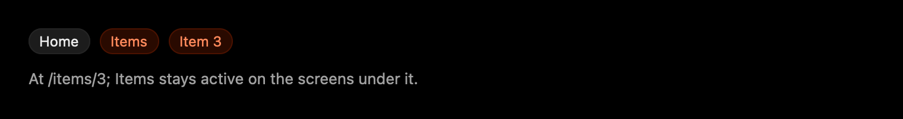

`<Link href="/items/3">` navigates on click. It is a real `<a>` in a page, so a modified click
opens a new tab, a click a child handler already prevented is left alone, and an `href` to another
site (`https:`, `mailto:`) is followed by the browser; in a window it is a focusable box, which
has nothing to open another site with. Its content snippet gets `{ active }`, true on that screen
and the ones below it (`exact` limits it to the path itself, and a query in `href` has to match
too), and a page's active link carries `aria-current="page"`. `replace` and `state` go to the
navigation. A `Link` needs no `Router` near it: these drive the same store as
the sample above.

```svelte demo link
<script>
  import { Badge, Link, router } from 'gpuix-svelte-ui';
</script>

<div class="row">
  {#each [['/', 'Home'], ['/items', 'Items'], ['/items/3', 'Item 3']] as [path, name]}
    <Link href={path}>
      {#snippet children({ active })}<Badge tone={active ? 'accent' : 'neutral'}>{name}</Badge>{/snippet}
    </Link>
  {/each}
</div>
<div class="note">At {router.path}; Items stays active on the screens under it.</div>

<style>
  .row { display: flex; flex-wrap: wrap; align-items: center; gap: 8px; margin-bottom: 10px; }
  .note { font-size: 13px; color: var(--ui-muted); }
</style>
```

## Responsive layouts

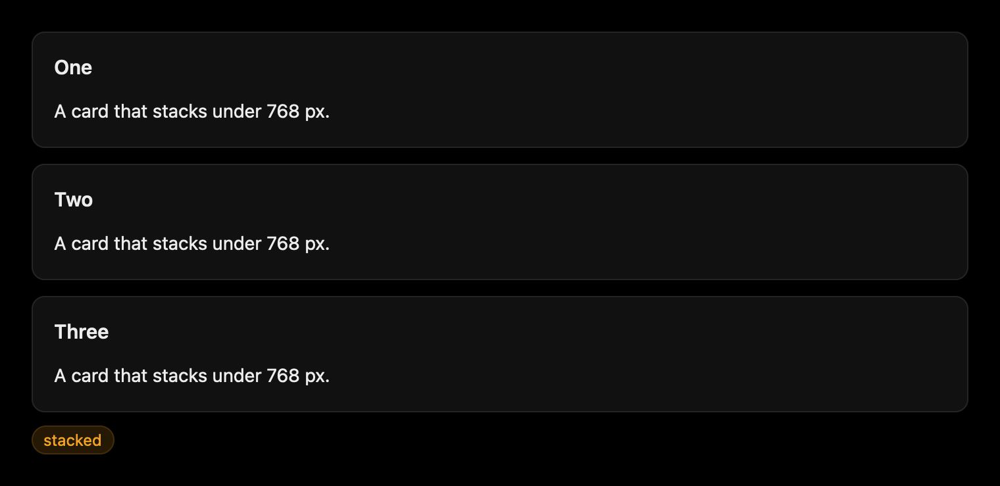

Both renderers answer `@media` queries over the window's width and height
([Styling](styling.md#media-queries)), and `media_query()` answers the same from JavaScript
([Guide](guide.md#media-queries)). The toolkit adds named breakpoints: `BREAKPOINTS` is
`{ sm: 480, md: 768, lg: 1024, xl: 1280 }`, `min_width('md')` is `media_query('(min-width: 768px)')`
and `max_width('md')` is `media_query('(width < 768px)')`, everything narrower, in the range form
that leaves no fractional width between the two. The window in the picture is 760 px wide, under
`md`, so it stacks; resize the browser to see both halves of this sample agree:

```svelte demo responsive
<script>
  import { Badge, Card, max_width } from 'gpuix-svelte-ui';

  const narrow = max_width('md');
</script>

<div class="cards">
  {#each ['One', 'Two', 'Three'] as title}
    <div class="cell"><Card {title}>A card that stacks under 768 px.</Card></div>
  {/each}
</div>
<div class="row">
  <Badge tone={narrow.current ? 'warning' : 'success'}>{narrow.current ? 'stacked' : 'side by side'}</Badge>
</div>

<style>
  .cards { display: flex; flex-direction: row; gap: 12px; }
  .cell { display: flex; flex-direction: column; flex-grow: 1; flex-basis: 0; }
  @media (width < 768px) {
    .cards { flex-direction: column; }
  }
  .row { display: flex; margin-top: 10px; }
</style>
```

## Writing your own

The helpers the components are built on are exported, so a component of your own can be
cross-target the same way (see [DOM](dom.md#writing-a-component-for-both) for the rules):

- `own_hitbox` spreads `hitbox="self"` on GPUI and nothing in the DOM, for a clickable box with
  painted children.
- `test_id(id)` spreads `testid` on GPUI and `data-testid` in the DOM, which is what every
  component's `testid` prop becomes.
- `aria_checked(checked)` spreads the state attribute each renderer's accessibility tree reads,
  and `aria_disabled(disabled)` the one that tells a page's screen reader a control is off (GPUI
  has no disabled state to set).
- `key_of(e)` spells a key event's key the GPUI way on both renderers (`enter`, `space`, `up`),
  `activates(e)` says whether it presses a button, `repeats(e)` whether the key is held, and
  `chorded(e)` whether Alt, Ctrl or Cmd is: the arrow keys of a control leave such a chord to
  the browser or the app (Alt+Left is Back).
- `bounds_of(node)`, `pointer_x(e)` and `still_pressed(e)` read a box, a pointer and a held
  button in one coordinate space, for drags. `{...drag_handlers(down, move, release)}` on the
  element pressed keeps a drag going past it and the window's edge: mouse handlers on GPUI,
  which captures the pointer for them, and pointer events with a capture in a page, so a finger
  drags too (give the element a `touch-action`). `Slider` is built on it.
- `focus_node(node)` focuses whatever an `{@attach}` handed over, and `holds_focus(node)` says
  whether the keyboard focus is on it or inside it.
- `MONO` is a monospace family each side has (`var(--ui-mono)` in CSS).

Every interactive component takes a `testid`, and the derived ids are documented on each prop
(`<testid>-input`, `<testid>-panel`, `<testid>-<value>`), so a headless test on GPUI
([Testing](testing.md)) and a DOM test find the same things: the repository's `test/ui.ts` and
`test/ui-dom.ts` click through the whole showcase that way.
